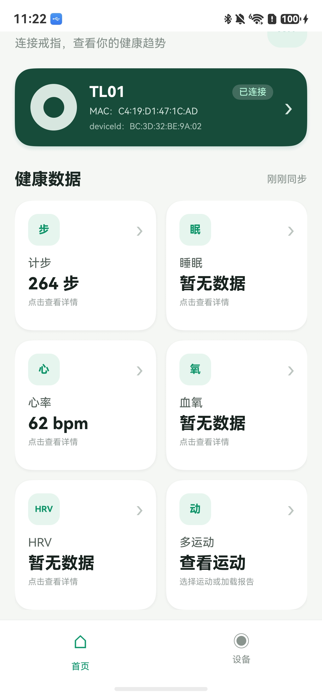
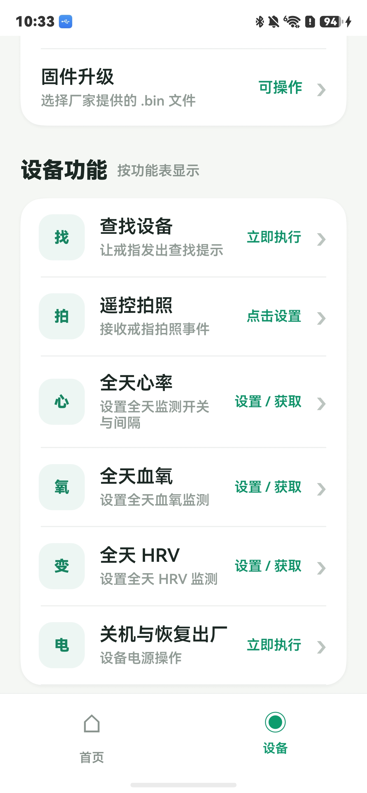

# RW HarmonyOS BLE SDK

本仓库用于对外提供 HarmonyOS BLE SDK 的 HAR 包、Demo 工程和接入文档。

## Demo 界面

<p align="center">
  
  
</p>

## 目录结构

```text
RW_HarmonyOS_SDK/
├── demo/                          # DevEco Studio Demo 工程
│   └── rw_ble_sdk_demo/            # Demo entry module
├── libs/
│   └── rw_ble_sdk.har              # SDK HAR 包
└── docs/
    ├── RW_HarmonyOS_SDK_集成指南.md # SDK 接入和 API 使用说明
    ├── harmonyos-demo-home.jpg      # Demo 首页效果图
    └── harmonyos-demo-device-features.jpg # Demo 设备功能页效果图
```

## 打开 Demo

请用 DevEco Studio 打开外层 Demo 工程目录：

```text
RW_HarmonyOS_SDK/demo
```

不要直接打开 `demo/rw_ble_sdk_demo`。`demo` 是 DevEco 工程目录，`rw_ble_sdk_demo` 是 entry module。

Demo 通过本地 HAR 依赖 SDK：

```json5
"rw_ble_sdk": "file:../../libs/rw_ble_sdk.har"
```

如果 DevEco 没有自动解析依赖，请在 `demo` 目录执行 `ohpm install` 后重新 Sync。

## 文档

SDK 初始化、扫描连接、API 调用、健康同步、实时健康数据、运动控制等说明见：

- [HarmonyOS SDK 集成指南](docs/RW_HarmonyOS_SDK_集成指南.md)
